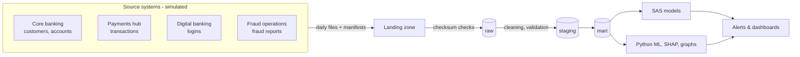

# Fraud Detection & Risk Analytics Platform

An end-to-end fraud analytics platform for a fictional retail bank, built the way real bank data teams work: from source systems and messy file deliveries, through ingestion and data quality, to SAS-based fraud models, explainable AI and investigator tooling.

> **All data is synthetic.** It is generated by this project's own simulator; no real customers, accounts or card numbers are used.

**Status:** in progress. Phases 1–2 are complete, Phase 3 is nearly complete. See the [roadmap](docs/roadmap.md).

---

## Architecture



## What's built so far

### 1. A simulated bank (Python, Faker)
- **3,000 customers**, 4,407 accounts, 3,000 debit cards, 500 merchants with real MCC codes, 3,700 devices
- **~456,000 transactions over 90 days** with running balances, salaries, transfers, bill payments and declines, calibrated so balances and decline rates stay realistic
- **~207,000 login events** in JSON Lines, with sessions, failed logins and travel

### 2. Realistic fraud, hidden in the data
| Pattern | Cases | Signal it leaves |
|---|---|---|
| Account takeover | 60 | Unknown device, foreign IP, night-time, rapid draining |
| Authorised push payment scams | 40 | Victim's own device; only a first-time payee stands out |
| Card-not-present fraud | 80 | $1–5 test charge, then a burst at high-risk online merchants |
| Money mules | 45 accounts | Young, new accounts that receive and quickly cash out |

Fraud is only revealed through a **delayed, incomplete fraud-report feed**, as in real banking: reports arrive days to weeks later, some fraud is never reported, and some claims are false. The bank only ever learns about roughly half of the fraudulent transactions.

### 3. Messy deliveries (by design)
About **14,000 deliberate data quality problems**: duplicates, missing values, amounts like `"$1,234.56"`, mixed date formats, unknown accounts, late-arriving rows, a truncated file that is re-sent, a late file, and schema drift (a renamed column and a new column). Every delivery day has a **manifest** with row counts and SHA-256 checksums.

### 4. Ingestion pipeline (PostgreSQL)
- Validates every file against its manifest and **rejects incomplete files**
- Loads data **exactly as delivered** into a `raw` layer, with lineage on every row
- Detects and records **schema drift** automatically
- **Idempotent**: running it twice never duplicates data
- **Atomic**: a file that fails mid-load leaves nothing behind
- Full audit trail in `audit.file_load_log` and `audit.schema_change_log`

### 5. Staging layer and data quality (SQL)
Raw text becomes clean, typed tables. Every problem is recorded with the action taken: **removed** (duplicates), **repaired** (reformatted, or recovered from a trusted field, e.g. a missing amount rebuilt from the balance change), **flagged** (bad value set to NULL, row kept), or **rejected** (left out, with the reason).

Measured against the answer key ([full report](reports/data_quality_report.md)):

| Metric | Result |
|---|---|
| Planted row-level problems detected | **14,185 of 14,185 (100% recall)** |
| False positives | **0** |
| Transaction repairs verified against the original data | **6,176 of 6,176 correct** |
| File-level problems detected (truncated, late, re-sent, schema drift) | **5 of 5** |

### 6. Answer keys for honest evaluation
Fraud labels and the list of planted data problems are kept in a separate ground-truth folder that the pipeline never reads. They are used only to measure how well the pipeline and models perform.

## Tech stack

Python (pandas, NumPy, Faker) · PostgreSQL 16 · Docker · SQLAlchemy + psycopg · pytest · Git
*Coming next:* Pandera, SAS OnDemand for Academics, scikit-learn, XGBoost, SHAP, NetworkX, Prefect, Streamlit, Tableau

## Engineering practices

- All settings in one config file ([`config/config.yaml`](config/config.yaml)); secrets in `.env`, never committed
- Structured logging throughout
- **94 automated tests**, including integration tests that run the pipeline against throwaway PostgreSQL databases and compare the cleaned data with the original truth
- Fully reproducible: the same seed produces identical data on any machine

## Project structure

```
config/        settings for the simulation and delivery
docs/          business case and roadmap
python/        simulator, delivery, ingestion, staging and reporting code
reports/       generated data quality report
sql/init/      database schemas and audit tables
sql/staging/   cleaning and validation rules (SQL)
tests/         automated tests
data/          generated locally, never committed
```

## Run it yourself

Requirements: Python 3.12+, Docker Desktop.

```bash
python3 -m venv .venv && source .venv/bin/activate
pip install -r requirements.txt
cp .env.example .env              # then set your own password
docker compose up -d              # start PostgreSQL

python3 python/run_simulation.py  # generate the bank's data (~35 s)
python3 python/run_pipeline.py    # ingest -> staging -> data quality report (~45 s)
pytest                            # run the test suite
```

## Documentation

- [Business case](docs/business_case.md): the problem, objectives, success metrics and constraints
- [Roadmap](docs/roadmap.md): all phases, with progress

---

**Author:** Abdullah Khaled Hasan Barabaa · [GitHub](https://github.com/ii2lxll)
